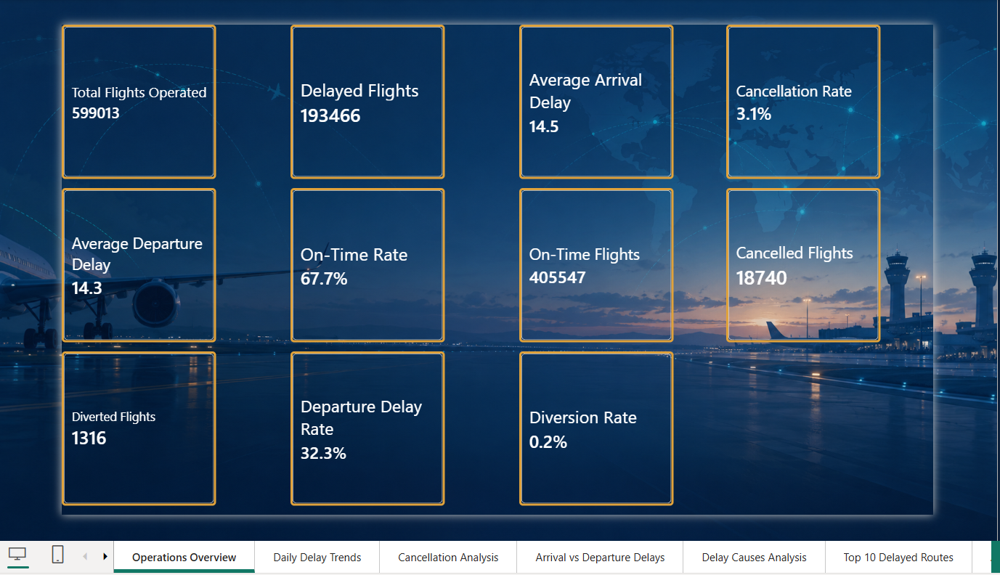
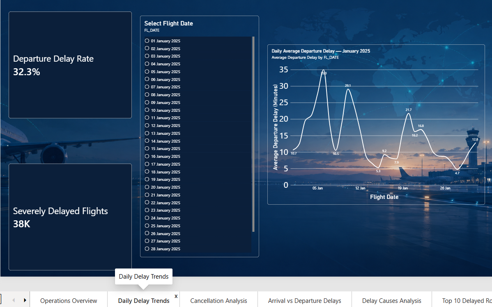
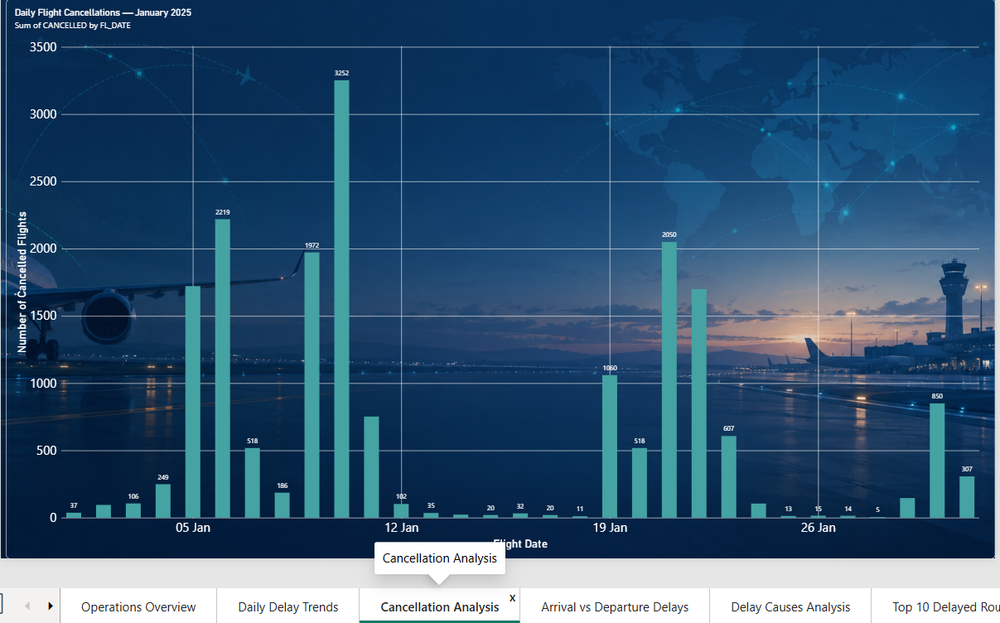
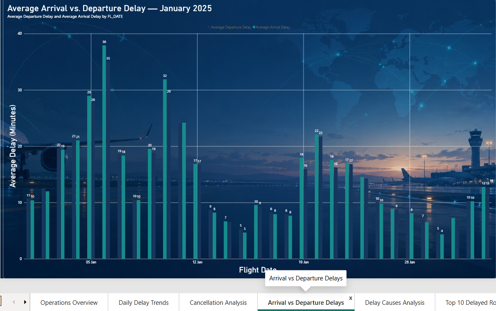
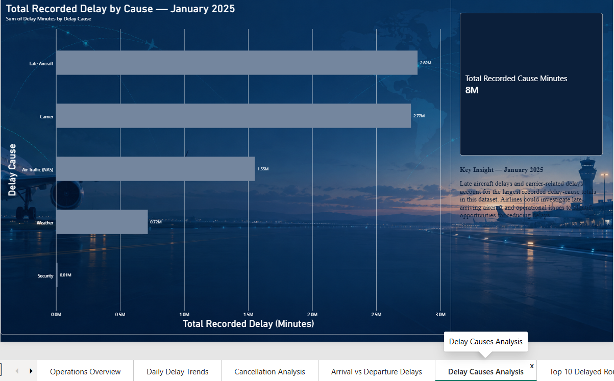
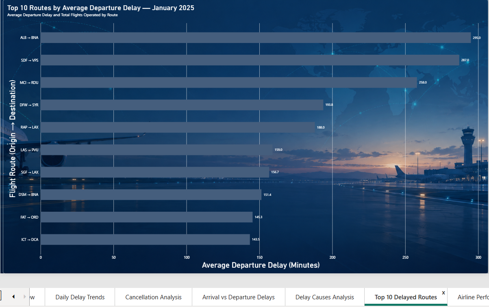
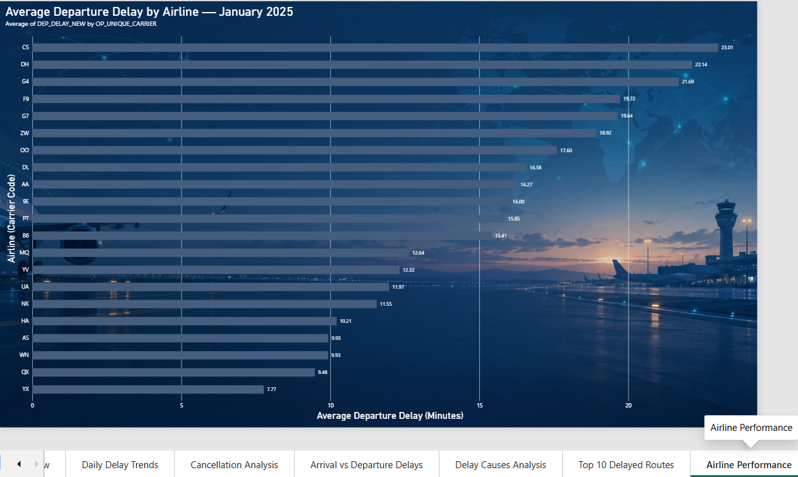

# FlightOps Intelligence ✈️

### Airline Operations Performance & Delay Investigation Platform

FlightOps Intelligence is a data analytics project designed to analyze airline operational performance, flight delays, cancellations, diversions, and delay causes using Python, SQL Server, and Power BI.

The project transforms raw flight operations data into an interactive dashboard to identify delay patterns, compare airline performance, and investigate operational inefficiencies.

## Project Objectives

- Analyze airline flight operations and performance.
- Measure departure and arrival delays.
- Track cancellations and diversions.
- Investigate recorded flight delay causes.
- Identify routes with high average departure delays.
- Compare operational performance across airlines.
- Present key performance indicators through interactive Power BI reports.

## Technology Stack

- **Python** — Data cleaning and preprocessing
- **Pandas** — Data manipulation
- **SQL Server Express** — Relational data storage and SQL analysis
- **SQL Server Management Studio (SSMS)** — Database management
- **Microsoft Power BI** — Interactive dashboards and visualization
- **Git and GitHub** — Version control and project hosting

## Dashboard Preview

### 1. Operations Overview

Provides a high-level view of flight operations, including total flights, delayed flights, average arrival and departure delays, cancellation rate, on-time performance, and diversions.



### 2. Daily Delay Trends

Shows daily departure-delay patterns throughout January 2025.



### 3. Cancellation Analysis

Visualizes daily flight cancellations to help identify changes in cancellation activity during the month.



### 4. Arrival vs Departure Delays

Compares average departure and arrival delays across flight dates.



### 5. Delay Cause Analysis

Examines recorded delay minutes across categories such as late-arriving aircraft, carrier, air traffic control (NAS), weather, and security.



### 6. Top 10 Delayed Routes

Ranks routes by average departure delay to highlight routes that may require further investigation.



### 7. Airline Performance

Compares average departure delay across airline carriers for January 2025.



## Dataset

The project uses US airline on-time performance data for January 2025.

The dataset includes:

- Flight date and carrier
- Flight number
- Origin and destination airports
- Departure and arrival delays
- Cancellation and diversion indicators
- Recorded delay-cause information

The raw and processed CSV files are excluded from Git tracking because of their size. Obtain the original dataset from the relevant official source and place the required raw CSV in `data/raw/`.

## Project Structure

```text
FlightOpsIntelligence/
├── data/
│   ├── raw/
│   └── processed/
├── documentation/
│   └── images/
│       └── images/
│           ├── operations-overview.png
│           ├── daily-delay-trends.png
│           ├── cancellation-analysis.png
│           ├── arrival-vs-departure-delays.png
│           ├── delay-cause-analysis.png
│           ├── top-10-delayed-routes.png
│           └── airline-performance.png
├── powerbi/
│   └── FlightOps_Intelligence.pbix
├── sql/
├── src/
│   └── data_cleaning.py
├── .gitignore
├── README.md
└── requirements.txt
```

## Getting Started

### 1. Clone the Repository

Replace the placeholder with your actual GitHub repository URL.

```bash
git clone <YOUR_GITHUB_REPOSITORY_URL>
cd FlightOpsIntelligence
```

### 2. Create and Activate a Python Virtual Environment

On Windows PowerShell:

```powershell
python -m venv .venv
.\.venv\Scripts\Activate.ps1
```

### 3. Install Dependencies

Install the required Python library using the provided dependency file.

```powershell
python -m pip install -r requirements.txt
```

### 4. Prepare the Dataset

Place the January 2025 raw flight operations CSV in `data/raw/` with the following filename:

`flight_operations_january_2025.csv`

Ensure that the dataset contains the columns expected by the cleaning script.

### 5. Run Data Cleaning

```powershell
python .\src\data_cleaning.py
```

The script:

- Reads the raw flight operations CSV.
- Converts flight dates into date values.
- Removes duplicate rows.
- Creates cancellation and diversion indicators.
- Creates departure-delay and arrival-delay indicators.
- Calculates total recorded delay-cause minutes.
- Saves the processed dataset in `data/processed/`.

### 6. Open the Power BI Dashboard

Open `powerbi/FlightOps_Intelligence.pbix` in Microsoft Power BI Desktop.

Configure or refresh the data source as needed for your local environment.

## Key Considerations

- Missing delay values should not automatically be treated as zero.
- Missing delay-cause values require careful interpretation.
- Cancellation and diversion records should be handled appropriately when calculating operational KPIs.
- Average delays can be influenced by flights with unusually large delays.
- The January 2025 dataset represents one month of operations and should not be treated as a complete picture of annual airline performance.

## Future Improvements

- Add SQL scripts for repeatable database setup and analysis.
- Implement automated data-quality checks.
- Expand the analysis to multiple months and years.
- Include route-level flight counts to provide context for average delays.
- Automate data refresh and reporting.

## Project Status

The Power BI dashboard and initial Python data-cleaning workflow have been developed. SQL scripts and additional documentation are planned improvements.

